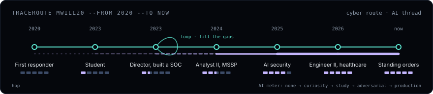
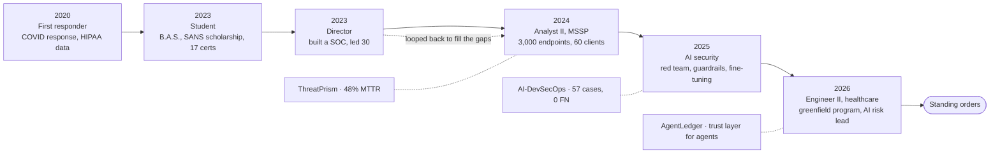
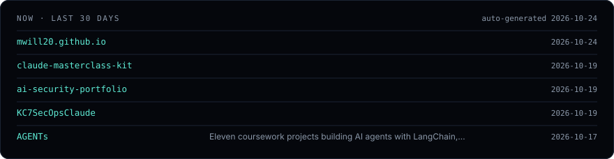
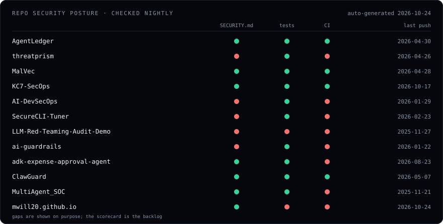

# Michael Williams

**Cybersecurity Engineer II at SEARHC.** Cybersecurity engineering, AI security, AI and software risk in a healthcare environment. Five years of security operations, and at every hop I stepped into the unknown and built things: solutions, my teams, and myself.

*Leveraging AI. As it evolves, so do I.*

### → [Follow the evidence: the full traceroute at mwill20.github.io](https://mwill20.github.io/)

Seattle, WA · GCIH · GCIA · GSEC · SecurityX · CAISS · MLSecOps · UT Austin McCombs AI/ML
[LinkedIn](https://www.linkedin.com/in/mwillitmission/) · [Project catalog](https://mwill20.github.io/ai-security-portfolio/) · [AgentLedger docs](https://mwillaimission.mintlify.app) · mwill.itmission@gmail.com

---

## The route

Student → director → analyst → engineer. I almost started at the finish line, then looped back to fill the gaps. As AI evolved, so did I: none, curiosity, study, adversarial, production.

## Now

Repositories pushed in the last 30 days. Rewritten nightly from the GitHub API, so this section cannot go stale.

## Repo security posture

Every featured repo, checked nightly for `SECURITY.md`, a tests directory, and a CI workflow. Gaps are shown on purpose; the scorecard is the backlog.

## Three lanes, one direction

| Lane | What it proves | Repos |
|---|---|---|
| **Detection and threat operations** | Detections, hunts, investigation automation at MSSP scale | [threatprism](https://github.com/mwill20/threatprism) · [MalVec](https://github.com/mwill20/MalVec) · [KC7-SecOps](https://github.com/mwill20/KC7-SecOps) · [MultiAgent_SOC](https://github.com/mwill20/MultiAgent_SOC) |
| **AI security and adversarial ML** | Attack, evaluate, and harden AI systems against real frameworks | [AI-DevSecOps](https://github.com/mwill20/AI-DevSecOps) · [LLM-Red-Teaming-Audit-Demo](https://github.com/mwill20/LLM-Red-Teaming-Audit-Demo) · [ai-guardrails](https://github.com/mwill20/ai-guardrails) · [SecureCLI-Tuner](https://github.com/mwill20/SecureCLI-Tuner) |
| **Agent security and AI risk** | Agentic systems built around the attack surface; AI risk assessment in healthcare | [AgentLedger](https://github.com/mwill20/AgentLedger) · [adk-expense-approval-agent](https://github.com/mwill20/adk-expense-approval-agent) · [ClawGuard](https://github.com/mwill20/ClawGuard) · [agent-config-sync](https://github.com/mwill20/agent-config-sync-public) |

## Standing orders

1. Everything is **untrusted** until proven otherwise.
2. Guardrails are **engineering**, not an afterthought.
3. Findings trace to **evidence**, or they are not findings.

---

This profile is tamper-evident. Each nightly render appends a SHA-256 hash-chained entry to <a href="ledger.jsonl">ledger.jsonl</a>.

<!-- ledger:start -->
`profile build #1` · `2026-10-24` · prev `sha256:0000…0000` · this `sha256:19f2…40e9` · verify with `python scripts/verify_ledger.py`
<!-- ledger:end -->

Cards are rendered by <a href=".github/workflows/cards.yml">a GitHub Action</a> from <a href="scripts/render_cards.py">standard-library Python</a>, hosted in this repo, with no third-party widgets. See <a href="SECURITY.md">SECURITY.md</a>.
